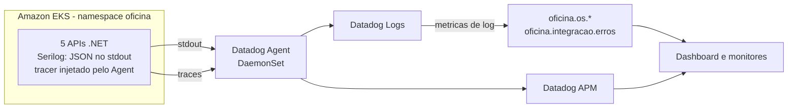

# Observabilidade (Datadog)

Este documento é o **contrato** entre o código das APIs (este repositório) e os recursos do Datadog criados por Terraform no repositório K8S (`infra/addons`). As métricas de log, os monitores e o dashboard filtram pelos nomes de eventos, propriedades e valores descritos aqui. **Ao mudar um nome ou valor deste contrato, mude também o Terraform do repo K8S**, e vice-versa.

- Decisão, consequências e alternativas: [ADR-014](./adr/ADR-014-Observabilidade-com-Datadog.md).
- Agent, métricas, monitores, synthetics, dashboard, secrets e liga/desliga (`DD_ENABLED`): `infra/DATADOG.md` do repositório [K8S](https://github.com/GuiToniello/tech-challenge-fase-3-K8S-soat16-rm374658), que espelha este contrato.

## 1. Visão geral

As 5 APIs escrevem 1 JSON por linha no stdout (Serilog). Na AWS, o Datadog Agent do repo K8S coleta esse stdout e injeta o tracer .NET nos pods do namespace `oficina` (APM). Os logs carregam o id do trace, e as métricas de negócio são calculadas a partir dos eventos de log, sem código de métricas nas APIs.



| Projeto | `service` (Deployment no repo K8S) | Prefixo no API Gateway |
|---|---|---|
| `TechChallenge.Oficina.Monolith.API` | `monolith-api` | `/monolith` |
| `TechChallenge.Oficina.ApprovalService.API` | `approval-api` | `/approval` |
| `TechChallenge.Oficina.CreateOSService.API` | `createos-api` | `/createos` |
| `TechChallenge.Oficina.GetOSService.API` | `getos-api` | `/getos` |
| `TechChallenge.Oficina.StatusService.API` | `status-api` | `/status` |

Todas usam `env:study`. As tags `service` e `env` vêm das labels `tags.datadoghq.com/service` e `tags.datadoghq.com/env` dos Deployments do repo K8S. Nada disso fica no código ou no Dockerfile.

## 2. Formato do log

Cada API configura o Serilog em `Extensions/LoggingExtension.cs` (por exemplo, [o da Monolith](../server/1%20-%20Frameworks%20%26%20Drivers/TechChallenge.Oficina.Monolith.API/Extensions/LoggingExtension.cs)):
- `AddLoggingConfiguration`: lê a seção `Serilog` da configuração e escreve no console com um `ExpressionTemplate`, 1 JSON por linha;
- `UseLoggingConfiguration`: grava 1 log por requisição (`UseSerilogRequestLogging`).

As camadas internas (UseCases e Controllers) usam só `ILogger<T>`; o Serilog fica nos projetos das APIs (ADR-001).

### 2.1 Chaves

`logger`, `dd` e `error` são objetos aninhados no JSON. O Datadog os achata em atributos com ponto (`logger.name`, `dd.trace_id`, `error.kind`), e é por esses nomes que eles são consultados.

| Atributo | Conteúdo | Uso no Datadog |
|---|---|---|
| `timestamp` | Data e hora do log em UTC (ISO 8601) | Data do log |
| `level` | Nível do Serilog: `Information`, `Warning`, `Error` ou `Fatal` (o `LogCritical` sai como `Fatal`) | Status do log: `info`, `warning`, `error` e `emergency` |
| `message` | Mensagem renderizada (os templates da aplicação são em português sem acentos; o `Motivo` de `os.falha` repete a mensagem da exceção de domínio, que pode ter acento, como "Cliente não encontrado.") | Texto do log. **Métricas e monitores nunca filtram por ela** |
| `evento` | `EventId.Name` do log (seção 3). Não aparece em log sem `EventId` | Filtro das métricas: `@evento:os.falha` |
| `logger.name` | Categoria do logger: em geral, o nome completo da classe do `ILogger<T>` | Atributo padrão de logger |
| `dd.trace_id`, `dd.span_id` | Ids do trace e do span ativos, injetados pelo tracer (`dd_trace_id` e `dd_span_id`). Só existem com um span ativo, em geral durante uma requisição | Liga o log ao trace no APM |
| `dd.service`, `dd.env`, `dd.version` | Injetados pelo tracer a partir de `DD_SERVICE`, `DD_ENV` e `DD_VERSION`. `dd.version` não aparece, porque não há `DD_VERSION` (imagens `:latest`) | Atributo de serviço |
| `error.kind`, `error.message`, `error.stack` | Tipo completo, mensagem e `ToString()` da exceção do log, com stack trace e inner exceptions | Error Tracking e painel de erro do log |
| Demais chaves | Propriedades do evento, em PascalCase (seção 3) | Atributos `@OrdemServicoId`, `@Etapa` etc. |

Regras do formato:
- **Fora do Datadog não há `dd`.** Localmente (`docker compose`) o JSON é o mesmo, só sem o objeto `dd`, porque não há tracer.
- **As chaves fixas prevalecem.** O template espalha primeiro as propriedades do evento (`..rest()`) e depois grava as chaves fixas. Uma propriedade com o mesmo nome de uma chave fixa (por exemplo, a propriedade `error` dos eventos de erro do EF Core) não sobrescreve a chave fixa.
- **`evento` só traz o nome.** O número do `EventId` (1001, 2001 etc.) não vai para o JSON.
- **`evento` também traz eventos do framework.** Qualquer log com `EventId` preenche `evento`, por exemplo `Microsoft.EntityFrameworkCore.Database.Command.CommandError` ou `Microsoft.EntityFrameworkCore.Migrations.MigrationApplying`. As métricas e os monitores filtram valores exatos, então esses nomes não interferem.
- **Números são números.** `TempoNoStatusAnteriorSegundos`, `TempoTotalSegundos`, `ValorTotal` e `QuantidadeServicos` saem como números JSON, o que permite a métrica de distribuição sobre `@TempoNoStatusAnteriorSegundos`.
- **Contexto da requisição.** Dentro de uma requisição, o JSON também pode trazer propriedades de contexto do ASP.NET Core, como `RequestId` e `RequestPath`. Elas não fazem parte do contrato.

### 2.2 Log de requisição

`UseSerilogRequestLogging` grava 1 log por requisição, sem `evento`, com a mensagem `HTTP {RequestMethod} {RequestPath} responded {StatusCode} in {Elapsed} ms` e a propriedade `RouteTemplate`: o template da rota, como `/api/ordens-servico/{id:guid}/aprovar-orcamento`. Por ter só placeholders, o `RouteTemplate` tem baixa cardinalidade e não traz ids.

A primeira linha da tabela que se aplicar define o nível:

| Requisição | Nível do log |
|---|---|
| Com exceção | `Error` |
| `/health` e `/health/ready`, incluindo o `503` do `/health/ready` com o banco fora | `Verbose`, abaixo do nível mínimo: **não gera log** (evita o ruído das probes, do NLB, do `http_check` e dos synthetics). Com o banco fora, o `HealthCheckService` já registra o resultado `Unhealthy` como `Error` (`evento` = `HealthCheckEnd`, ou `HealthCheckError` se o check lançar exceção) |
| Status ≥ 500 | `Error` |
| Demais, incluindo 4xx | `Information` |

### 2.3 Nível mínimo

Seção `Serilog` do `appsettings.json` de cada API: `MinimumLevel.Default` = `Information`, com `Warning` para `Microsoft.AspNetCore`, `Microsoft.EntityFrameworkCore.Database.Command` e `System.Net.Http.HttpClient`. O `docker-compose.yml` e os ConfigMaps do repo K8S sobrescrevem só `Serilog__MinimumLevel__Default` e `Serilog__MinimumLevel__Override__Microsoft.AspNetCore`.

### 2.4 Exemplos

Cada log é **uma linha**. Os valores abaixo são ilustrativos.

Local (`docker compose`, sem tracer, portanto sem `dd`):

```json
{"OrdemServicoId":"3f6b2c1e-8d4a-4b7e-9c21-5a0e7d9f1b23","ClienteId":"9a1d5e7c-2b4f-4c8a-b6e3-0f7d1c2a3b45","VeiculoId":"c4e8a2b6-1d3f-4e5a-8b7c-9d0e1f2a3b4c","QuantidadeServicos":2,"timestamp":"2026-10-14T13:40:02.1184506Z","level":"Information","message":"Ordem de servico 3f6b2c1e-8d4a-4b7e-9c21-5a0e7d9f1b23 criada para o cliente 9a1d5e7c-2b4f-4c8a-b6e3-0f7d1c2a3b45 e o veiculo c4e8a2b6-1d3f-4e5a-8b7c-9d0e1f2a3b4c com 2 servicos.","evento":"os.criada","logger":{"name":"TechChallenge.Oficina.UseCases.Features.OrdensServico.UseCases.OrdemServicoUseCases"}}
```

Na AWS (com o tracer injetado, portanto com `dd`):

```json
{"OrdemServicoId":"3f6b2c1e-8d4a-4b7e-9c21-5a0e7d9f1b23","StatusAnterior":"aguardando_aprovacao","StatusNovo":"em_execucao","Etapa":"orcamento_aprovacao","TempoNoStatusAnteriorSegundos":1834.5271234,"timestamp":"2026-10-14T14:10:36.6455740Z","level":"Information","message":"Ordem de servico 3f6b2c1e-8d4a-4b7e-9c21-5a0e7d9f1b23 alterada de aguardando_aprovacao para em_execucao na etapa orcamento_aprovacao apos 1834.5271234 segundos no status anterior.","evento":"os.status_alterado","logger":{"name":"TechChallenge.Oficina.UseCases.Features.OrdensServico.UseCases.OrdemServicoUseCases"},"dd":{"trace_id":"6703f9a4000000005b3e9d1c4f2a8e71","span_id":"8812093476615509287","service":"approval-api","env":"study"}}
```

Erro com exceção (banco indisponível; mensagem e stack encurtados com `...`):

```json
{"RequestMethod":"POST","RouteTemplate":"/api/ordens-servico/{id:guid}/aprovar-orcamento","Integracao":"postgres","timestamp":"2026-10-14T14:12:09.0412377Z","level":"Error","message":"Erro nao tratado em POST /api/ordens-servico/{id:guid}/aprovar-orcamento: postgres indisponivel","evento":"http.erro_nao_tratado","logger":{"name":"TechChallenge.Oficina.Monolith.API.Middleware.GlobalExceptionHandlerMiddleware"},"error":{"kind":"System.InvalidOperationException","message":"An exception has been raised that is likely due to a transient failure. ...","stack":"System.InvalidOperationException: ...\n ---> Npgsql.NpgsqlException (0x80004005): ...\n   at ..."}}
```

## 3. Catálogo de eventos

Os eventos de OS saem do [use case](../server/3%20-%20Application%20Business%20Rules/TechChallenge.Oficina.UseCases/Features/OrdensServico/UseCases/OrdemServicoUseCases.cs) e do [controller](../server/2%20-%20Interface%20Adapters/TechChallenge.Oficina.Controllers/Features/OrdensServico/OrdensServicoController.cs) de ordens de serviço, que são compartilhados pelas 5 APIs: nenhum endpoint de OS passa por fora deles. Os `EventId` de 1001 a 3001 e os valores da seção 4 ficam em [OrdemServicoLogEventos.cs](../server/3%20-%20Application%20Business%20Rules/TechChallenge.Oficina.UseCases/Features/OrdensServico/Logging/OrdemServicoLogEventos.cs). O 9001 fica nos middlewares globais, e o 9002, no `Program.cs` das APIs.

| Evento (`EventId`) | Nível | Onde é emitido | Propriedades |
|---|---|---|---|
| `os.criada` (1001) | Information | `OrdemServicoUseCases.CriarAsync`, depois de `AdicionarAsync`. Cobre `POST /api/ordens-servico` e `POST /api/ordens-servico/completa` (`monolith-api` e `createos-api`) | `OrdemServicoId`, `ClienteId`, `VeiculoId`, `QuantidadeServicos` |
| `os.status_alterado` (1002) | Information | `OrdemServicoUseCases.RegistrarTransicao`, chamado depois de `AtualizarAsync` em `AlterarStatusParaEmDiagnosticoAsync`, `GerarOrcamentoAsync` (só quando o status muda), `AprovarOrcamentoAsync`, `RecusarOrcamentoAsync`, `AlterarStatusParaEmExecucaoAsync`, `AlterarStatusParaFinalizadaAsync` e `AlterarStatusParaEntregueAsync` (`monolith-api` e `approval-api`) | `OrdemServicoId`, `StatusAnterior`, `StatusNovo`, `Etapa`, `TempoNoStatusAnteriorSegundos` (número: tempo entre a entrada no status anterior e a mudança) |
| `os.encerrada` (1003) | Information | `OrdemServicoUseCases.AlterarStatusParaEntregueAsync`, depois de gravar. **OS encerrada é a OS entregue** (status `Entregue`) | `OrdemServicoId`, `TempoTotalSegundos` (número: de `Recebida` a `Entregue`, por `ObterTempoEntrega()`) |
| `os.orcamento_gerado` (1004) | Information | `OrdemServicoUseCases.GerarOrcamentoAsync`, depois de gravar | `OrdemServicoId`, `ValorTotal` (número), `Regerado` (`true` quando a OS já tinha orçamento; nesse caso não há `os.status_alterado`) |
| `os.orcamento_enviado` (1005) | Information | `OrdemServicoUseCases.EnviarOrcamentoPorEmailAsync`, depois do envio pelo Resend | `OrdemServicoId`, `ValorTotal` (número) |
| `os.falha` (2001) | Warning | `OrdensServicoController.RegistrarFalha`, chamado em cada `catch` das 12 ações que alteram estado (seção 4.1). Registra só o motivo, sem a exceção | `Etapa`, `OrdemServicoId` (`null` na abertura, quando a OS ainda não existe), `TipoFalha`, `Motivo` (mensagem da exceção de domínio) |
| `integracao.falha` (3001) | Error | `OrdemServicoUseCases.EnviarOrcamentoPorEmailAsync`, em volta só de `OrcamentoEmailSender.EnviarOrcamentoAsync`: qualquer exceção que não seja `DomainException` nem cancelamento da requisição (o timeout do `HttpClient` conta como falha). Registra e relança, então a requisição termina em 500 | `Integracao` = `resend`, `Operacao` = `envio_orcamento`, `OrdemServicoId`, `error.*` |
| `integracao.falha` (3001) | Warning | `OrdemServicoUseCases.EnviarNotificacaoStatusAlteradoAsync`, no envio do e-mail de mudança de status. A falha, inclusive o timeout do `HttpClient`, é engolida (modo degradado) e a mudança de status continua valendo; só o cancelamento da requisição é propagado. **Inativo na AWS** (seção 8) | `Integracao` = `resend`, `Operacao` = `notificacao_status`, `OrdemServicoId`, `StatusNovo`, `error.*` |
| `http.erro_nao_tratado` (9001) | Error | `GlobalExceptionHandlerMiddleware`, uma cópia em `Middleware/` de cada API (as 5). Não registra a requisição abortada pelo cliente (responde 499; ver observações) | `RequestMethod`, `RouteTemplate`, `Integracao` = `postgres` **só** quando o banco está indisponível, `error.*` |
| `app.migracao_falhou` (9002) | Critical (`Fatal` no JSON) | `Program.cs` das 4 APIs que aplicam migrations no startup (Monolith, CreateOS, GetOS e Status), em volta de `ApplyMigrations()`. A API encerra com código 1 e o pod entra em CrashLoopBackOff | `error.*` |

Observações:
- **Falha ao buscar o cliente para a notificação de status**: sai um `Warning` sem `EventId` e sem `Integracao`, porque não é falha do Resend. Não conta em `oficina.integracao.erros`.
- **Resend sem configuração**: sem `ApiKey` ou `FromEmail`, o `OrcamentoEmailSender` lança `DomainException`. O caso aparece como `os.falha` (`Etapa` = `orcamento_envio`, `TipoFalha` = `regra_negocio`, HTTP 400), e não como `integracao.falha`. Chave inválida ou Resend fora do ar geram `integracao.falha` e um 500 na rota.
- **Banco indisponível**: [FalhasBanco.cs](../server/1%20-%20Frameworks%20%26%20Drivers/TechChallenge.Oficina.DB/FalhasBanco.cs) (projeto DB) percorre a cadeia de `InnerException`, porque a execution strategy do Npgsql embrulha as falhas transitórias em `InvalidOperationException`. A cadeia é lida de fora para dentro e decide no primeiro destes tipos: `OperationCanceledException` não conta, porque é cancelamento (o timeout do `HttpClient` no envio pelo Resend ou a consulta cancelada quando o cliente abandona a requisição, os dois com uma `TimeoutException` interna); `PostgresException` só conta quando é transitória (`IsTransient`); outra `NpgsqlException` ou `TimeoutException` conta sempre. Violação de restrição (`PostgresException` 23xxx, como excluir um cliente que tem OS) **não** é falha de integração: o `http.erro_nao_tratado` sai sem `Integracao`, com `error.kind` = `Microsoft.EntityFrameworkCore.DbUpdateException`; a `PostgresException` e o `SqlState` aparecem no `error.stack`.
- **Cliente que desconecta**: se a requisição é abortada pelo cliente (`OperationCanceledException` com `RequestAborted` cancelado), o middleware responde 499 sem log de erro. O log da requisição sai como `Information` (status < 500) e o APM não conta 5xx.

## 4. Valores permitidos

Os valores são fixos, em `snake_case`, e viram tags das métricas (`etapa`, `tipo_falha`, `status_anterior` e `integracao`). Renomear um valor quebra o histórico da série e os filtros do dashboard e dos monitores.

### 4.1 `Etapa`

A coluna "Transição" vale para `os.status_alterado`; as demais etapas aparecem só em `os.falha`. As rotas estão na raiz de cada API; pelo API Gateway, ganham o prefixo da API (seção 1).

| Valor | Ação do controller | Rota | Transição (`StatusAnterior` → `StatusNovo`) |
|---|---|---|---|
| `abertura` | `Post`, `PostCompleta` | `POST /api/ordens-servico`, `POST /api/ordens-servico/completa` | — |
| `atualizacao` | `Put` | `PUT /api/ordens-servico` | — |
| `exclusao` | `Delete` | `DELETE /api/ordens-servico/{id}` | — |
| `diagnostico` | `AlterarParaEmDiagnostico` | `POST /api/ordens-servico/{id}/em-diagnostico` | `recebida` → `em_diagnostico` |
| `orcamento_geracao` | `GerarOrcamento` | `POST /api/ordens-servico/{id}/gerar-orcamento` | `recebida` ou `em_diagnostico` → `aguardando_aprovacao` (gerar de novo em `aguardando_aprovacao` não muda o status) |
| `orcamento_envio` | `EnviarOrcamento` | `POST /api/ordens-servico/{id}/enviar-orcamento` | — |
| `orcamento_aprovacao` | `AprovarOrcamento` | `POST /api/ordens-servico/{id}/aprovar-orcamento`, `POST /api/approval/aprovar/{id}` | `aguardando_aprovacao` → `em_execucao` |
| `orcamento_recusa` | `RecusarOrcamento` | `POST /api/ordens-servico/{id}/recusar-orcamento`, `POST /api/approval/recusar/{id}` | `aguardando_aprovacao` → `finalizada` |
| `execucao` | `AlterarParaEmExecucao` | `POST /api/ordens-servico/{id}/em-execucao` | `em_diagnostico` ou `aguardando_aprovacao` → `em_execucao` |
| `finalizacao` | `AlterarParaFinalizada` | `POST /api/ordens-servico/{id}/finalizar` | `em_execucao` → `finalizada` |
| `entrega` | `AlterarParaEntregue` | `POST /api/ordens-servico/{id}/entregar` | `finalizada` → `entregue` |

### 4.2 `TipoFalha`, `Integracao` e `Operacao`

| Propriedade | Valor | Quando |
|---|---|---|
| `TipoFalha` | `regra_negocio` | `DomainException`: regra de negócio violada (HTTP 400) |
| `TipoFalha` | `nao_encontrado` | `KeyNotFoundException`: OS, cliente, veículo, serviço ou insumo inexistente (HTTP 404) |
| `Integracao` | `resend` | Falha no envio de e-mail (`integracao.falha`) |
| `Integracao` | `postgres` | Banco indisponível (`http.erro_nao_tratado`) |
| `Operacao` | `envio_orcamento` | Envio do orçamento por e-mail (`Integracao` = `resend`) |
| `Operacao` | `notificacao_status` | E-mail de mudança de status (`Integracao` = `resend`) |

### 4.3 Status (`StatusAnterior` e `StatusNovo`)

Convertidos por `OrdemServicoLogEventos.StatusParaLog`, a partir do enum `StatusOrdemServico`:

| Enum | Valor no log |
|---|---|
| `Recebida` (1) | `recebida` |
| `EmDiagnostico` (2) | `em_diagnostico` |
| `AguardandoAprovacao` (3) | `aguardando_aprovacao` |
| `EmExecucao` (4) | `em_execucao` |
| `Finalizada` (5) | `finalizada` |
| `Entregue` (6) | `entregue` |
| `Encerrada` (7) | `encerrada` (previsto no enum, mas nenhum fluxo usa esse status) |

## 5. Mapa evento → métrica → dashboard e monitores

As métricas de log são criadas por Terraform no repo K8S. Todas têm também a tag `env` (sem `group_by`, a métrica não teria tag nenhuma).

| Evento | Métrica | Tipo e filtro | Tags (`group_by`) | Widget do dashboard | Monitor |
|---|---|---|---|---|---|
| `os.criada` | `oficina.os.criadas` | count, `@evento:os.criada` | `env` | OS criadas por dia (barras) | — |
| `os.encerrada` | `oficina.os.encerradas` | count, `@evento:os.encerrada` | `env` | OS encerradas por dia (barras) | — |
| `os.status_alterado` | `oficina.os.tempo_no_status` | distribution de `@TempoNoStatusAnteriorSegundos`, `@evento:os.status_alterado` | `status_anterior` (de `@StatusAnterior`), `env` | Tempo médio por status, em minutos | — |
| `os.falha` | `oficina.os.falhas` | count, `@evento:os.falha` | `etapa` (de `@Etapa`), `tipo_falha` (de `@TipoFalha`), `env` | Falhas de negócio por etapa | — (o e2e gera 400 de propósito) |
| `integracao.falha` e `http.erro_nao_tratado` com `Integracao` | `oficina.integracao.erros` | count, `@Integracao:*` (conta os níveis `Error` e `Warning`) | `integracao` (de `@Integracao`), `env` | Erros de integração | `oficina.integracao.erros` > 0 em 15 min |
| `http.erro_nao_tratado` | — (o 5xx vem do APM: `trace.aspnet_core.request.errors`) | — | `service`, `resource_name` | 5xx por rota | 5xx por rota > 0 |
| `os.orcamento_gerado`, `os.orcamento_enviado` | — | — | — | — (consulta no Log Explorer) | — |
| `app.migracao_falhou` | — | — | — | Logs de erro recentes (sai como `Fatal`, que o Datadog mostra com status `emergency`) | — (a falha de migração aparece nos monitores de CrashLoopBackOff e restarts) |

- O widget **Logs de erro recentes** lista os logs das APIs com `status:(error OR emergency)`: todo log `Error` (como `http.erro_nao_tratado` e o `integracao.falha` do envio de orçamento) e o `app.migracao_falhou`, que é `Fatal`. Uma consulta só com `status:error` deixa a falha de migração de fora.
- Os ids (`OrdemServicoId`, `ClienteId`, `VeiculoId`) são atributos de log e **nunca** viram tags de métrica (cardinalidade).
- As métricas de log não têm backfill: só contam os eventos ingeridos depois que a métrica existe. Para popular o dashboard, rode o fluxo de OS (collections em `/e2e`) depois do deploy do Datadog.
- Os demais widgets e monitores (latência p95, CPU e memória, restarts, nós, réplicas, `http.can_connect`, synthetics e SLO) usam métricas do APM e do Agent, sem depender dos logs. Estão no `infra/DATADOG.md` do repo K8S.

## 6. Health checks

| Endpoint | Verifica o banco? | Resposta | Quem usa |
|---|---|---|---|
| `/health` | Não | Inalterada (a Approval responde `Healthy`; as demais, `{"status": "..."}`) | Probes do Kubernetes (incluindo o `readinessProbe`), NLB, API Gateway, `HEALTHCHECK` dos Dockerfiles, e2e e synthetics do Datadog (`GET /<api>/health` pelo API Gateway) |
| `/health/ready` | Sim (`AddDbContextCheck`, check `postgres` com a tag `ready`) | `Healthy` (200) ou `Unhealthy` (503) | Só o `http_check` do Datadog Agent (service check `http.can_connect`) |

Os dois são anônimos e não geram log de requisição, nem o `503` do `/health/ready` com o banco fora: nesse caso, a falha aparece no log `Error` do próprio `HealthCheckService`, com o check `postgres` (seção 2.2). O `readinessProbe` continua em `/health` para que uma queda do banco não tire todos os pods do Service.

## 7. Consultas úteis

No Log Explorer do Datadog:

| Para ver | Consulta |
|---|---|
| Falhas de negócio | `@evento:os.falha` |
| Falhas de uma etapa | `@evento:os.falha @Etapa:orcamento_aprovacao` |
| Recursos inexistentes | `@evento:os.falha @TipoFalha:nao_encontrado` |
| Erros de integração (Resend e banco) | `@Integracao:*` |
| Só e-mail ou só banco | `@Integracao:resend` ou `@Integracao:postgres` |
| Erros 500 | `@evento:http.erro_nao_tratado` |
| Histórico de uma OS | `@OrdemServicoId:<guid>` |
| Transições para um status | `@evento:os.status_alterado @StatusNovo:em_execucao` |
| Erros de uma API (inclui o `Fatal`, que vira `emergency`) | `service:approval-api status:(error OR emergency)` |
| Falha de migração no startup | `@evento:app.migracao_falhou` |

A busca por atributo diferencia maiúsculas de minúsculas: use os nomes e valores exatamente como estão aqui.

**Do log ao trace:** abra um log que tenha `dd.trace_id`. A aba **Trace** do painel do log mostra a requisição inteira (rota, tempos e erro) e abre o trace no APM ("View trace"). No caminho inverso, a aba **Logs** de um trace no APM lista os logs daquela requisição. Logs fora de uma requisição (no startup, por exemplo) não têm trace.

Localmente, filtre o stdout de um serviço do `docker-compose.yml` (`api` é a Monolith):

- Linux/macOS: `docker compose logs api | grep '"evento":"os.falha"'`
- Windows PowerShell: `docker compose logs api | Select-String '"evento":"os.falha"'`

## 8. E-mail de mudança de status inativo na AWS

O `integracao.falha` com `Operacao` = `notificacao_status` só pode aparecer quando o e-mail de mudança de status está ligado. Na AWS, `ResendSettings:SendEmailOnStatusChange` é `false`: o valor vem do `appsettings.json` da imagem, e o repo K8S não define `ResendSettings__SendEmailOnStatusChange`. Com isso, o `OrdemServicoStatusEmailSender` retorna sem chamar o Resend e esse caminho fica inativo. Para exercitá-lo, defina `ResendSettings__SendEmailOnStatusChange=true`, além da `ResendSettings__ApiKey`. O envio do orçamento (`Operacao` = `envio_orcamento`) não depende dessa chave.

## 9. Regras

- **Sem dados pessoais (PII).** Nunca logar CPF/CNPJ, e-mail, nome, placa ou JWT. Os logs levam só GUIDs e os valores fixos deste documento. O `Motivo` de `os.falha` é a mensagem da exceção de domínio, que não traz dados pessoais (no máximo o nome de um insumo ou quantidades); mensagens novas de domínio seguem a mesma regra.
- **Ids nunca são tags.** `OrdemServicoId` e demais ids são atributos de log, nunca `group_by` de métrica.
- **Serilog só nas APIs.** UseCases e Controllers usam `ILogger<T>` (ADR-001).
- **Mudança no contrato**, como um evento, uma propriedade ou um valor novo ou renomeado:
  1. altere o código (`OrdemServicoLogEventos.cs` e o ponto de log);
  2. atualize este documento;
  3. atualize o Terraform do repo K8S (`infra/addons/modules/datadog/`) e o `infra/DATADOG.md` de lá, se a mudança afetar métricas, monitores ou o dashboard.
